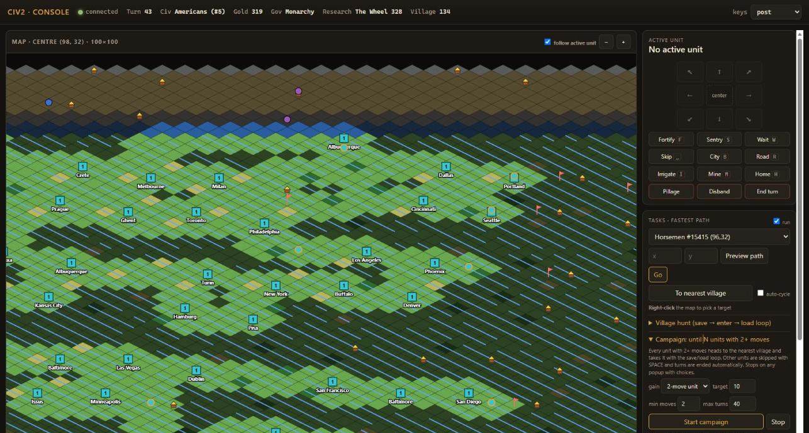
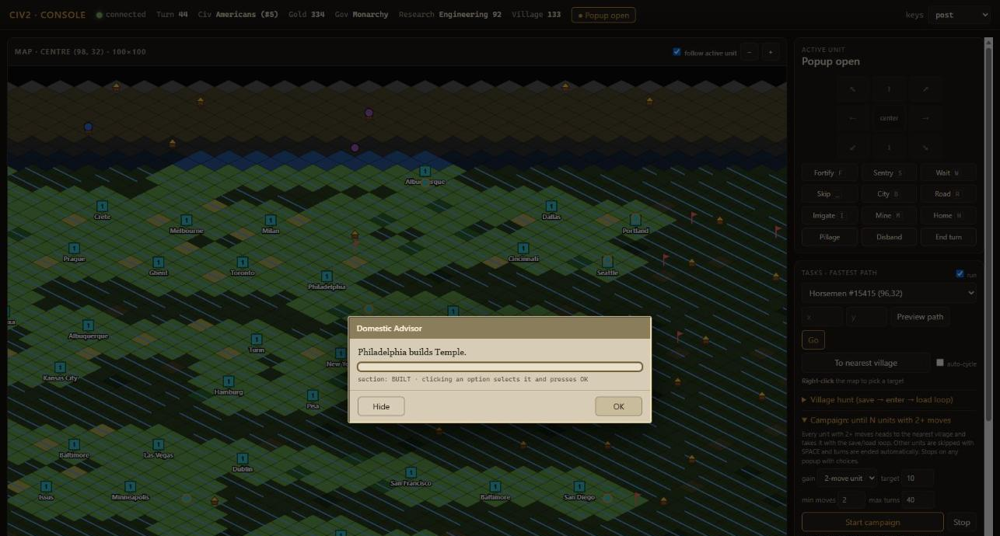
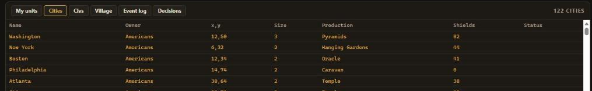

# civ2api — Agent API for Civilization II MGE

Lets an AI agent (or you) play *Civilization II: Multiplayer Gold Edition* through an HTTP API instead of screenshots. It reads the memory of the running `CIV2.EXE` (ReadProcessMemory) to expose game state, and performs actions by sending **keystrokes** and window messages. No DLL injection, and `CIV2.EXE` on disk is never modified.



- Stage 2 (`memwrite.py`) can also write a small whitelist of fields — city production, worked tiles/entertainers, tax/science rates — each followed by a read-back check and logged with old/new values. Everything else stays read-only.

- Language: Python 3.8+ (ctypes, **stdlib only**). No third-party packages, so no lockfile and zero supply-chain risk.
- Fog of war: unfiltered (the agent sees everything). Every tile carries an `explored_mask`, so a fair-play mode can be added later.
- Target build: MGE 5.4.0f (Patch 3), `CIV2.EXE` = 2,489,344 bytes. Any other size is refused at attach time.

## Layout

| File | Purpose |
|---|---|
| `civ2api/memmap.py` | Addresses and offsets (source: `memory-map.md`) |
| `civ2api/win32.py` | ctypes: OpenProcess/ReadProcessMemory, EnumWindows, PostMessage, SendInput |
| `civ2api/state.py` | Reads game, units, cities, civs, popup, tiles; detects Civ2UIA units-limit relocation |
| `civ2api/rules.py` | Unit/improvement/tech/tribe names from RULES.TXT |
| `civ2api/events.py` | Diff of two snapshots → events (new enemy unit, HP dropped, city lost, popup …) |
| `civ2api/session.py` | Polling thread + event log + actions (move, command, key, answer_dialog) |
| `civ2api/server.py` | HTTP API + web console on `127.0.0.1:8765` |
| `civ2api/console.html` | Single-page web console |
| `civ2api/pathfind.py` | Fewest-turns pathfinder (Dijkstra over RULES.TXT move costs) |
| `civ2api/tasks.py` | Goto task runner |
| `civ2api/hunt.py`, `civ2api/campaign.py` | Village hunt (save → enter → load) and multi-unit campaign |
| `civ2api/citysite.py` | City site finder (21-tile yield score, no overlap) |
| `civ2api/cityops.py` | City operations through the game's own windows (open city, change production, fix disorder) |
| `civ2api/memwrite.py` | Stage 2: whitelisted memory writes with read-back |
| `civ2api/gameio.py`, `civ2api/turnsave.py` | Save/load via Civ2's menu; automatic save at the start/end of every turn |
| `civ2api/journal.py` | Decision protocol: every agent action with the reason, in `logs/decisions.jsonl` |
| `civ2api/goals.py` | Player goals (cities, gold, wonder, tech, government, no disorder/starving, villages left) with live progress |
| `civ2api/panels.py` | Data for the console panels: alerts, rivals, government, research, saves |
| `civ2api/roadnet.py` | Road/railroad network linking all cities (minimum spanning tree over road-building cost) |
| `civ2api/buy.py` | Buy production with gold through the City Window's own Buy button |
| `mvp_units.py`, `mvp_move.py` | MVP checks |
| `tools/backup_game.py` | Back up the game folder + CIV2.EXE sha256 |
| `tools/file_bridge.py` | File-queue bridge for agents that can't reach `127.0.0.1` |
| `tests/` | Offline tests: decode logic against fake memory, pathfinder (run on any OS) |

## Requirements

- Windows, Civilization II MGE 5.4.0f (Patch 3); [Civ2-UI-Additions](https://github.com/FoxAhead/Civ2-UI-Additions) recommended (start the game with `Civ2UIALauncher.exe`)
- Python 3.8+ on `PATH` (64-bit is fine)

## Running (Windows)

```bat
:: 0. Backup (always first)
python tools\backup_game.py "C:\...\Civ2"

:: 1. Load a game, then list your units
python mvp_units.py
python mvp_units.py --watch          :: live events

:: 2. Move the active unit one step
python mvp_move.py NE
python mvp_move.py NE --keys sendinput   :: if PostMessage does not work

:: 3. API server
python -m civ2api.server
```

> A 64-bit Python can read the 32-bit Civ2 process. Admin rights are usually not needed (if Civ2 runs as admin, run Python as admin too).

## API

| Method | Path | Description |
|---|---|---|
| GET | `/health` | pid, units_base, scale flags, warnings |
| GET | `/state` | Full state |
| GET | `/state/units?owner=me\|all\|<id>` | Unit list |
| GET | `/events?since=<seq>&wait=<sec>` | Events (long-poll) |
| GET | `/tiles?x=&y=&w=&h=` | Map window |
| GET | `/unit_types` | Unit type rules |
| GET | `/dialogs` | Popup (from memory: title, lines, options, buttons) + Win32 windows |
| POST | `/act` | `{"action":"move","dir":"NE"}`, `{"action":"fortify"}`, `{"action":"key","key":"shift+d"}` |
| POST | `/answer_dialog` | `{"option":1,"button":"ok"}` — selects with arrow keys, then Enter |
| GET | `/protocol?since=<seq>` | Decision log (what the agent did and why) |
| GET/POST | `/city_sites`, `/found_cities` | Best city sites; send settlers to found cities there |
| POST | `/production`, `/tax_rates`, `/fix_disorder`, `/research_plan` | City/kingdom management |
| POST | `/end_turn` | Save, then end the turn |
| GET | `/turn_saves` | List of per-turn saves |

| GET | `/alerts` | Enemy units near cities, disorder/riot/starving, wonder race, low gold, stopped jobs |
| GET | `/rivals` | Every civ: cities, population, techs, army, wonders built / in production |
| GET | `/government`, `/research` | Government, rates, plan; research queue status. `POST /gov_rates`, `/government_plan`, `/revolution`, `/research_plan` |
| GET/POST | `/goals`, `/goals/delete` | Player goals with progress |
| GET | `/reports` | One report per turn (gold, rates, unhappy, disorder, starving, goals) |
| GET/POST | `/wonders`, `/wonders/plan` | Wonder cities, progress, caravans on the way |
| POST | `/buy` | Buy the current production of a city |
| GET/POST | `/saves`, `/rollback` | All saves; roll back to one (stops jobs, loads, restarts the campaign) |

Endpoints under `/dev/*` are low-level debugging helpers.

Each `act` sends keystrokes, re-reads state until it settles, and returns the events caused by that action.

## Web console

Running `run_console.bat` starts the server windowless (`pythonw -m civ2api.server`) and opens **http://127.0.0.1:8765/** in the browser. The server listens on `127.0.0.1` only and rejects requests with any other Host or Origin.

- **Map:** follows the active unit. Clicking a neighbouring tile moves the unit there; hovering shows tile, unit and city info.
- **Controls:** 8-direction pad, Fortify, Sentry, Wait, Skip, City, Road, Irrigate, Mine, Home, Pillage, Disband, End turn. The last three ask for confirmation. Any key can be sent manually.
- **Browser shortcuts:** numpad or arrows = move; F, S, W, B, R, I, M, H; Space = skip. While a popup is open: Enter, Esc, digits = choose option.
- **Popup:** title, lines, options and buttons are shown in a Civ2-style window. "Hide" closes it so you can see the map; the "● Popup open" button at the top reopens it.
- **Villages:** shown on the map as yellow huts. The "Village" tab is sorted by distance from the active unit. API: `GET /huts`, bridge: `{"op":"huts"}`. Locations are computed from the map seed with the hut formula, counting only unowned tiles.
- **Tabs:** My units, My cities (filters: riot, disorder, starving, wonder, no Temple, caravans), Alerts, Charts (cities, techs, population, rates, problem cities over time), Government, Research, Rivals, Villages, Turn reports, Goals, Saves (one-click rollback), Event log, Decisions — all live via long-poll.
- **`keys` option:** `post` (default, works even with the game in the background) or `sendinput`.

Real Civ2 popups are mirrored in the console and can be answered from there:



The Cities tab (122 cities in this game):



*Screenshots: a live MGE game (Deity, Americans, turn 43–44) while a village-hunt campaign was running.*

When the game isn't running the console shows "Civ2 is not running"; the server reconnects automatically once it starts. To stop the server, end `pythonw.exe` in Task Manager.

## Unit tasks (goto, fastest path)

- **From the console:** in the "Tasks" panel select a unit, then **right-click** the map to pick a target. The path is previewed with turn numbers: yellow = terrain, brown = road. Then press "Go". "To nearest village" targets the closest village.
- **API:** `GET /plan?unit_id=&x=&y=`, `POST /tasks {"unit_id","x","y"}`, `GET /tasks`, `POST /tasks/cancel`, `POST /tasks/settings {"enabled","auto_cycle"}`. Via bridge: `{"op":"api","method":"POST","path":"/tasks","body":{...}}`.
- **Pathfinder (`pathfind.py`):** minimises the number of turns. Terrain costs come from RULES.TXT. Road↔road (city = road) = ⅓, railroad = 0. Rivers give no movement bonus in MGE (measured in-game). Avoids ocean, foreign units/cities and zones of control. A unit with full MP can always enter any tile. Wraps in x on round maps.
- **Runner (`tasks.py`):** each time a tasked unit becomes active, it replans, presses one step and verifies the move. If MP is insufficient it tries once, otherwise presses SPACE and waits for next turn. Stops on popups. With `auto-cycle` on, if an untasked unit is active it presses W to cycle to a tasked one.

## Village hunting (save → enter → load loop)

The **"Village hunt"** section of the console's "Tasks" panel:
1. Select a unit and enter the village x,y (right-click or "To nearest village"). Set "min moves" (default 2), "max attempts", and optionally a "go next" coordinate.
2. **Start**: the unit travels next to the village (without entering other villages on the way). As soon as the game activates that unit, it saves to `civ2api/saves/hut_X_Y_HHMMSS.sav`.
3. It enters the village, reads and closes every popup, and checks memory for a new unit. Success if the new unit's moves ≥ min. The original unit then continues to the "go next" coordinate if given.
4. On failure it loads the save and retries. On reaching max attempts it reloads the pre-entry state and stops.

API: `POST /hunt {"unit_id","x","y","min_moves":2,"max_attempts":20,"then":[x,y]}`, `GET /hunt`, `POST /hunt/cancel`.
Save/Load: `POST /game/save {"name"}`, `POST /game/load {"name"}`. Sends Civ2 menu commands (Save 684, Load 685) via `WM_COMMAND` and fills the Windows file dialog via Win32. Never overwrites an existing file.

**Note:** Civ2 assigns **new IDs** to units on every load (slot index is unchanged). The runner and hunt track units by (slot, type, owner).

## Campaign: until N units with 2+ moves

Start with `POST /campaign {"target":10,"min_moves":2,"max_turns":40}` or from the console's "Campaign" section. Every unit with 2+ moves becomes a "hunter": it heads next to the nearest village not claimed by another hunter and runs the village hunt (save → enter → load) once active. Newly gained units become hunters too. Other units are skipped with "Skip Turn", and when nothing is left "End Player Turn" is sent from the menu. Stops and asks you on popups with choices.

Tested 2026-10-27: over turns 18–21 (~3.5 minutes) it took 6 villages and grew the 2+-move units from 4 to 10 (1–7 attempts per village).

## File bridge (the method verified on this machine)

For when the agent cannot reach Windows `127.0.0.1` (e.g. its shell runs in a Linux VM):

1. Start Civ2 **via `Civ2UIALauncher.exe`** (do not launch `civ2.exe` directly).
2. Run `run_bridge.bat` once. It starts a windowless `pythonw` that logs to `logs/bridge.log`, and stops any old bridge.
3. Command: `queue/in/<name>.json` → reply: `queue/out/<name>.json`.

```json
{"op":"units","owner":"me"}
{"op":"act","action":"move","dir":"NE","unit_id":17}
{"op":"answer_dialog","option":4,"button":"ok"}
{"op":"dialogs"}   {"op":"events","since":0}   {"op":"tiles","x":108,"y":34,"w":5,"h":5}
{"op":"huts"}   {"op":"console"}   {"op":"restart"}   {"op":"stop"}
```

After updating the code, send `{"op":"restart"}` so the bridge reloads it. To stop the bridge: `{"op":"stop"}`, or end `pythonw.exe` in Task Manager.

## MVP results (2026-10-27)
- Read my units (type, position, HP, moves) live from the running game.
- Sending `NUM9` moved the Elephant (110,36)→(111,35) and `moves_left` went 2→1, confirmed both in memory and on screen.
- Read popups (LOADOK, MAINMENU) and answered them through the API.

## Known limitations

- Popup text is not a Win32 control (custom-drawn), so it is read from memory (`0x6CEC84`). `@options` lines come from GAME.TXT and are matched to child windows by position. The currently highlighted line of an `@options` popup can't be read yet (list-box popups such as production are read from memory).
- Orders go to the **active** unit. Other units are reached by cycling (`W`/`SPACE`) or `POST /activate` (View Pieces + cursor + Activate Unit).
- Calendar year is not computed (only `year_counter`).
- Tribe names are the RULES.TXT defaults; names entered at game start are not shown.
- Keystroke commands (`COMMANDS`) are the Civ2 Orders menu shortcuts; verify on each build.

## Disclaimer

Unofficial fan project, not affiliated with or endorsed by the rights holders of Civilization II. No game files are included; you need your own copy of Civ2 MGE 5.4.0f. Memory addresses were derived from the open-source [Civ2-UI-Additions](https://github.com/FoxAhead/Civ2-UI-Additions) and [Civ2-clone](https://github.com/axx0/Civ2-clone) projects — see `memory-map.md`.
